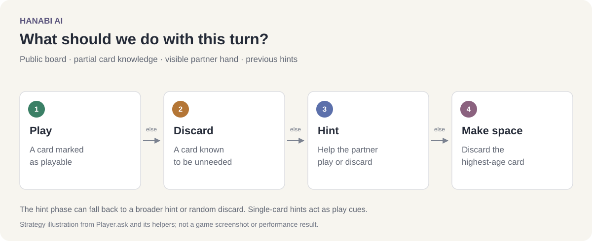

# Hanabi AI

Hanabi AI is a Java project exploring cooperation with hidden information. Two agents play [Hanabi](https://en.wikipedia.org/wiki/Hanabi_(card_game)), where each player can see their partner's cards but has to learn about their own hand through hints.

The strategy keeps track of what each player knows, looks for useful plays and discards, and chooses hints that help the other player act.



*Decision order in `Player.ask`, including the fallback choices used when selecting a hint.*

## Motivation

In many games, finding a good move means looking further ahead. Hanabi adds a different problem: your partner has information you need, and communicating it uses a limited resource.

We wanted to explore how a small set of shared conventions could help two agents work together. A hint can communicate a card's number or color, but the choice of which hint to give can also suggest what to do next. The challenge is balancing that communication with making progress on the board and preserving cards that may still be needed.

## The game

This implementation has two players with five cards each. Together they build five colored stacks in order from 1 to 5, for a maximum score of 25.

On a turn, an agent can:

- **Play a card.** A correct play advances a stack. An incorrect play consumes one of three fuses.
- **Discard a card.** This makes room for a new card and restores a hint token, up to the limit of eight.
- **Give a hint.** Spend a token to identify every card of one number or color in the partner's hand.

The game harness ends when the deck is empty, all stacks are complete, or the fuses run out. Running out of fuses gives a score of zero.

## How the strategy works

The agents use rules and a partial knowledge base. They track the known color and number of their own cards, the partner's visible hand, and an estimate of what the partner knows.

The main decision order is:

1. **Play a card marked as playable.** Complete card information can establish a legal play. The agents also use conventions, such as treating a hint that singles out one card as a cue to play it.
2. **Discard a card known to be unneeded.** A card may already be on the board, belong to a completed color, or belong to a color whose next required card has been exhausted in the discard pile.
3. **Give a useful hint.** Prefer a hint that enables a play, then one that identifies discards. The hint manager considers both the visible cards and the partner's existing knowledge. Broader hints and a random-discard fallback are used when it cannot find a useful cue.
4. **Discard the card with the highest tracked age.** If none of the earlier options applies, make room for another card.

A shared convention treats a single-card hint as a signal to play that card.

The strategy is split across:

| File | Responsibility |
| --- | --- |
| [Player.java](src/Player.java) | Knowledge updates, turn initialization, and action priority |
| [HintManager.java](src/HintManager.java) | Finding play/discard hints and choosing fallback hints |
| [DiscardManager.java](src/DiscardManager.java) | Classifying cards that can be discarded |
| [Hanabi.java](src/Hanabi.java) | Dealing, turns, action handling, and game completion |
| [Board.java](src/Board.java) | Public stacks, hints, fuses, and discards |

## Running the project

Use JDK 21 with `java` and `javac` available. The project uses the Java standard library.

```sh
git clone https://github.com/TheDeafOne/hanabi-AI.git
cd hanabi-AI
mkdir -p out
javac -d out src/*.java
java -cp out Driver
```

[Driver.java](src/Driver.java) runs 1,000 games between two instances of the strategy. It prints each game's score and the final average. Example output:

```text
Game 0 score: 13
Game 1 score: 16
Game 2 score: 13
Game 3 score: 17
Game 4 score: 15
```

Decks and fallback hints are randomized for each run.

For turn-by-turn output, the driver includes a commented example using `new Hanabi(true)`. The verbose mode prints hands, actions, and the board after each turn. [Testcases.java](src/Testcases.java) contains development examples for inspecting the strategy.

## Project team

[Player.java](src/Player.java) credits **AlthoffLJ, WoodburnKB, and BennettKE**. The repository contains the agent strategy, its helpers, and the game harness.
